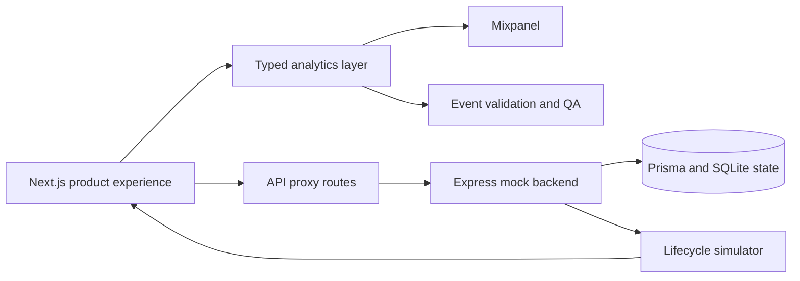

# Product Analytics Instrumentation Platform

An end-to-end product analytics implementation for a complex financial web application. The work connects user journeys, frontend event tracking, backend lifecycle simulation, validation, and analytics-ready event contracts.

## Problem solved

Large products often emit inconsistent analytics events that cannot be trusted across signup, checkout, accounts, payouts, identity verification, subscriptions, and affiliate workflows. This project establishes a typed event model and a realistic local backend so analytics behavior can be validated against complete lifecycle states.

## Architecture

## Technology

Next.js · React · TypeScript · Mixpanel · TanStack Query · Material UI · Express · Prisma · SQLite · Zod · Pino

## Engineering highlights

- Models analytics events around real product journeys instead of page views alone.
- Uses typed payloads and consistent naming across frontend modules.
- Mirrors production API contracts through a local stateful backend.
- Simulates account, payment, KYC, payout, and subscription transitions.
- Provides event mirroring and QA checkpoints for implementation review.
- Separates public showcase material from proprietary application code and customer configuration.

## Documentation

- [Architecture](docs/architecture.md)
- [Event design](docs/event-design.md)
- [Privacy and security](docs/security.md)

> The production application, customer flows, credentials, and event data are not included in this public showcase.
