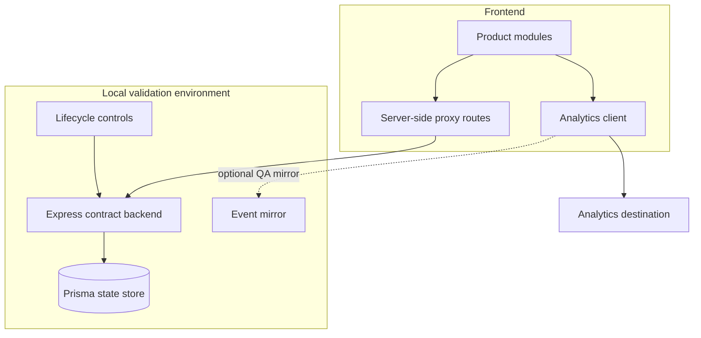

# Architecture

The frontend owns event intent and typed payload construction. Proxy routes preserve the product's API boundary. The mock backend reproduces state transitions needed to test event sequences without production dependencies.
